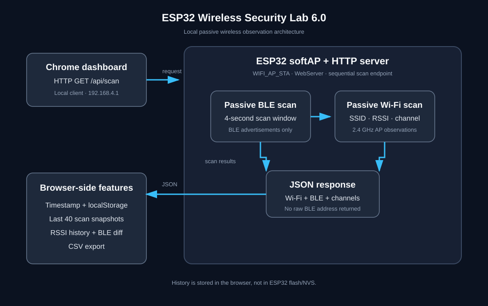
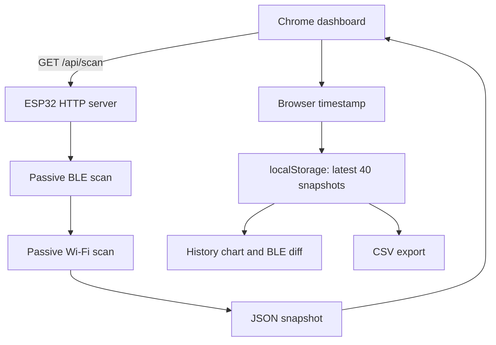

# Architecture and data flow

## High-level components

### Firmware

- **SoftAP:** Starts `ESP32-Wireless-Lab` with a password configured in `AP_PASSWORD`.
- **HTTP server:** `WebServer` listens on port 80 and serves the embedded dashboard at `/`.
- **Scan API:** `GET /api/scan` runs the BLE scan and then the Wi-Fi scan, returning a JSON snapshot.
- **Wi-Fi scanner:** Uses the ESP32 Arduino Wi-Fi scan API with passive scanning enabled, records SSID/RSSI/channel/security label, counts channels 1–13, and sorts by RSSI.
- **BLE scanner:** Uses passive BLE advertisement scanning. A short FNV-1a-derived observation ID is returned instead of the raw address.

### Browser dashboard

- Renders Wi-Fi, BLE, and channel observations.
- Stamps each response with the browser's local clock (`Date` in the browser).
- Stores up to 40 snapshots in `localStorage` under `esp32WirelessLabHistoryV6`.
- Draws the strongest Wi-Fi RSSI over time.
- Compares BLE observation IDs between the latest two snapshots.
- Builds the CSV download from browser-stored snapshots.

## Scan sequence

1. Browser requests `GET /api/scan`.
2. Firmware performs a 4-second passive BLE scan.
3. Firmware performs a passive Wi-Fi scan.
4. Firmware returns JSON with Wi-Fi records, BLE records, and channel counts.
5. Browser adds a timestamp, appends the snapshot to history, trims history to 40 records, and saves it locally.
6. Dashboard updates its cards, tables, chart, and BLE comparison.

The scan handler is synchronous. During a scan, the ESP32 is busy servicing the request; a dashboard request may take several seconds to complete. The page disables the manual scan button while a request is in progress and schedules another scan every 30 seconds.

## Data flow diagram

## Network model

The ESP32 runs in AP + station mode (`WIFI_AP_STA`): the soft AP hosts the dashboard while the station interface is used for passive scanning. The device is not configured to join any scanned access point. The dashboard is local to the ESP32 access point and does not require cloud services or internet connectivity.
